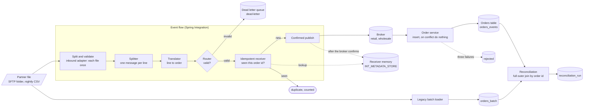

# Architecture: replacing a nightly file drop with an event flow

Component names match the lesson's diagram ("The partner's orders as a message flow"): **Partner file**, **Split and validate**, **Idempotent receiver**, **Broker**, **Order service** and **Orders table**, plus what the lesson adds in later steps: the **Dead letter queue**, the **Legacy batch loader** and the **Reconciliation** that compares the two paths.

## Components and what each owns

| Component | Where it lives | What it owns |
| --- | --- | --- |
| **Partner file** (the SFTP folder) | `atmoz/sftp` in [`docker-compose.yml`](docker-compose.yml), generator [`GeneratePartnerFile`](src/main/java/plainround/orderflow/application/GeneratePartnerFile.java), adapter [`SftpPartnerDrop`](src/main/java/plainround/orderflow/infrastructure/sftp/SftpPartnerDrop.java) | The partner's nightly CSV of orders (10,000 lines, a few planted bad ones, duplicates when a file is sent twice). |
| **Split and validate**: inbound adapter | [`OrderFlowConfiguration#ingestFlow`](src/main/java/plainround/orderflow/infrastructure/flow/OrderFlowConfiguration.java) | Polls the folder, fetches each new `.csv` once (a persistent accept-once filter whose memory is a database table), downloads it into the local inbox. |
| **Split and validate**: splitter | `Files.splitter().markers()` in the same flow | One message per line; start and end markers around a file, which carry the file name and the line count. |
| **Split and validate**: translator and filter | `lineFlow`, domain [`OrderParser`](src/main/java/plainround/orderflow/domain/OrderParser.java) | Drops the header line; turns a line into an `Order` or a `Rejection` (a Result4J `Result`, no exceptions for expected bad input). |
| **Split and validate**: router | `lineFlow` (`route(Result::isError)`) | Sends refused lines to the dead-letter path and valid orders on. |
| **Dead letter queue** | `invalidFlow`, [`ConfirmedPublisher#publishDeadLetter`](src/main/java/plainround/orderflow/infrastructure/amqp/ConfirmedPublisher.java), queue `dead-letter` | The line, the reason and the file name, kept for a person. |
| **Idempotent receiver** | `validFlow`, a `JdbcMetadataStore` region `orders` | "Have I published this order id already?" It is a lookup before the publish and a record after the broker's confirmation ([ADR 1](docs/adr/0001-remember-the-order-after-the-broker-confirms.md)). |
| **Broker** | RabbitMQ, topology in [`RabbitTopology`](src/main/java/plainround/orderflow/infrastructure/amqp/RabbitTopology.java) | Durable queues `retail` and `wholesale` (one per order type, both dead-lettering to `rejected`) and `dead-letter`. |
| **Orders table** | [`sql/001_schema.sql`](sql/001_schema.sql) (`orders_events`) | One row per order from the new path; the order service is its only writer. |
| **Order service** | [`OrderListener`](src/main/java/plainround/orderflow/infrastructure/amqp/OrderListener.java), use case [`ProcessOrderMessage`](src/main/java/plainround/orderflow/application/ProcessOrderMessage.java), [`JdbcOrderStore`](src/main/java/plainround/orderflow/infrastructure/jdbc/JdbcOrderStore.java) | Consumes an order, writes `orders_events` with `ON CONFLICT DO NOTHING`. The second idempotent point ([ADR 2](docs/adr/0002-two-idempotent-points-and-two-tables.md)). |
| **Legacy batch loader** | [`LegacyBatchLoader`](src/main/java/plainround/orderflow/infrastructure/jdbc/LegacyBatchLoader.java) | The old way: reads the same files, loads `orders_batch`. Kept running, untouched, until the retirement condition is met. |
| **Reconciliation** | [`ReconcileOrders`](src/main/java/plainround/orderflow/application/ReconcileOrders.java), [`sql/reconcile.sql`](sql/reconcile.sql), [`RetirementPolicy`](src/main/java/plainround/orderflow/domain/RetirementPolicy.java) | The morning comparison of the two tables, its recorded history, and the rule for when the legacy path may go ([ADR 4](docs/adr/0004-run-both-paths-and-retire-on-a-number.md)). |

## Why each pattern is there

| Pattern (box in the diagram) | One sentence on why it is there |
| --- | --- |
| **Channel Adapter** (SFTP inbound adapter) | The partner only knows how to drop a file, so the flow polls the folder and fetches each file once instead of asking the partner to change. |
| **Splitter** | One order is the unit of work, so a file of 10,000 lines becomes 10,000 messages that can fail, retry and be counted one by one. |
| **Message Filter** (the header line) | The first line names the columns and is not an order, so it is dropped before it can be mistaken for a bad one. |
| **Message Translator** (`OrderParser`) | The rest of the system should see an `Order`, not a comma-separated line; the translator is the only place that knows the file format. |
| **Content-Based Router** (valid or not) | A bad line must not stop the file or reach the broker, so the router sends it down its own path and the good ones down theirs. |
| **Dead Letter Channel** (`dead-letter` queue) | A refused line keeps its text and its reason where a person can fix and resend it, instead of disappearing into a log. |
| **Idempotent Receiver** (the memory of order ids) | The partner resends files, so duplicates are removed here, after validation and before the broker, and a crash between the confirm and the record costs one repeated publish, never a lost order. **This is where duplicates are removed (the first of two places).** |
| **Guaranteed Delivery** (durable queues, publisher confirms) | An order is forgotten by the flow only when the broker says it has it. |
| **Idempotent Consumer** (the order service) | The broker delivers at least once, so the table, not the queue, makes a repeat harmless: `ON CONFLICT DO NOTHING`. **The second place duplicates are removed.** |
| **Content Enricher** | Not used: the order in the file carries everything the order service needs. |

State, as the lesson asks to mark it: the **receiver's memory** (`INT_METADATA_STORE`) and the **broker** hold state; the adapter, splitter, translator, filter and router can be restarted freely. What happens to a bad message at each box: the filter drops the header; the translator turns a bad line into a `Rejection`; the router sends it to the dead-letter queue; the receiver never sees it; the broker holds a good order until the service takes it; the service stores it, or after three failures sends it to `rejected`.

## Pattern: enterprise integration patterns on Spring Integration, rules in plain Java

The flow is built from named patterns (Channel Adapter, Splitter, Message Filter, Message Translator, Content-Based Router, Dead Letter Channel, Idempotent Receiver, Competing Consumers) and each stage is a few lines in a Java DSL. What a valid order is lives in `domain` and does not know Spring; the use cases `ProcessOrderMessage` and `ReconcileOrders` depend on ports (`OrderStore`, `ReconciliationSource`, `ReconciliationHistory`, `PartnerDrop`); Spring Integration, Spring AMQP, JDBC and SFTP implement them in `infrastructure`. `ArchitectureTest` enforces the layers ([ADR 5](docs/adr/0005-ports-and-adapters.md)).

## Data flow

### One week, step by step (`make demo-week`)

1. `make up` and `make db` start PostgreSQL, RabbitMQ and the SFTP server and create `INT_METADATA_STORE`, `orders_batch`, `orders_events`, `legacy_loaded_file` and (as a migration) `reconciliation_run`.
2. `make partner` (the `partner` command) generates the day's file with a seed and uploads it to the SFTP folder.
3. The flow's inbound adapter finds the new file, downloads it and remembers its name; the splitter emits a start marker, then one message per line, then an end marker.
4. The header is dropped. Each line becomes an `Order` or a `Rejection`. Rejections go to `dead-letter` with the reason.
5. For each valid order the receiver looks the id up in its memory. A new id is published, by its type, to the `retail` or `wholesale` queue with a confirm; only after the broker confirms is the id written to the memory. A known id goes to the discard channel and is counted as a duplicate.
6. The order service consumes both queues; `INSERT ... ON CONFLICT (order_id) DO NOTHING` writes `orders_events`. Three failures in a row reject the message to `rejected` without requeue.
7. `make legacy-load` loads the files it has not loaded into `orders_batch`.
8. `make reconcile` runs one `FULL OUTER JOIN` of the two tables and prints four counts (only in batch, only in events, different, same) and the ids behind any difference; the result is appended to `reconciliation_run`. When 14 runs in a row are clean it prints that the legacy path may be retired.

## Decisions and trade-offs

**Remember after the confirm** ([ADR 1](docs/adr/0001-remember-the-order-after-the-broker-confirms.md)). This deliberately replaces Spring Integration's `MetadataStoreSelector`, which records first. A killed process after the record and before the publish would lose the order for good. Our order is publish, confirm, record, so the worst case is one more publish, which the second idempotent point absorbs.

**Two idempotent points, two tables** ([ADR 2](docs/adr/0002-two-idempotent-points-and-two-tables.md)).

**Confirms, durable queues, two dead-letter queues** ([ADR 3](docs/adr/0003-synchronous-confirms-and-two-dead-letter-queues.md)). A publish is a synchronous confirmed call, 5 seconds at most; a nack is an exception and the file is left unmarked, so the next poll takes it again.

**Both paths run, and a number decides** ([ADR 4](docs/adr/0004-run-both-paths-and-retire-on-a-number.md), [`docs/CUTOVER.md`](docs/CUTOVER.md)).

**The SQL for the comparison is a file** ([`sql/reconcile.sql`](sql/reconcile.sql)), not Java; the numbers the report prints come from one statement a data engineer can read and run in `psql`.

**Operability.** Configuration comes from the environment, validated at startup; logging is JSON on standard error; `health` checks the database, the broker and the SFTP folder; the exit codes are 0 clean, 1 failed, 2 differences found by `reconcile`; the flow and the order service shut down gracefully (Spring stops the pollers and the listener containers before the pools).

## Failure modes the lesson teaches, and how to reproduce each

| Failure | What you see | Reproduce |
| --- | --- | --- |
| **The partner sends the same file again** | no new order, and the dead-letter queue keeps its 3 lines; the duplicate counter equals the 10,000 lines | `make partner-again` |
| **A malformed line** | the line and its reason in `dead-letter`; the rest of the file flows | `make partner` (a few lines are planted bad) |
| **The broker restarts in the middle** | the publisher waits and tries again every two seconds (up to five minutes); nothing lost, nothing doubled: the orders are still `n` in `orders_events` | `make demo-restart`, `ConfirmedPublisherTest` |
| **The order service is down** | orders wait in the durable queue and arrive when it returns | `make demo-restart` |
| **A crash between the confirm and the record** | the order is published twice, stored once | `ReplaceFileDropE2E`, the restart phase |
| **The new path misses or invents an order** | `reconcile` prints the ids and exits 2, and the retirement counter resets | `make demo-week` (a planted difference) |
| **A poison message** | three tries, then `rejected` | `StoresAndBrokerIT` |

## Limits of the teaching build against production

- **A broker that stays away longer than five minutes** makes the publish fail; the flow then stops in the middle of the file, and Spring Integration does not roll the file filter back, so that file is not read again by itself. Before this retry existed, a broker restart did exactly that (1,069 of 9,997 orders arrived); production adds a rollback of the filter on failure (the Spring Integration reference describes a transaction synchronization that removes the failed file) or a re-drop of the file.
- **One flow instance.** The accept-once filter and the metadata store are in the database, so two instances would not double-publish, but they would race on the same file; production adds a lock or partitions the folder.
- **Synchronous confirms.** About a millisecond per publish on a local broker; a fast partner needs batched or asynchronous confirms (ADR 3).
- **A lookup and an insert per order** in the receiver's memory; fine at 10,000 a night, a cache or a bulk lookup beyond that.
- **The partner's folder is a stand-in** (a container). A real partner means keys instead of a password, a known-hosts check, and a firewall allow-list.
- **Plain-text credentials in `.env`** for a throwaway local stack, no TLS to the broker.
- **The ordering of orders between files is not guaranteed** and the model does not need it: an order is an immutable fact keyed by its id.

## How to extend it

- **Replace the file with an HTTP or message endpoint** (the cutover's step 1): add an inbound adapter on the `valid` channel; the receiver, the broker and the service are unchanged.
- **Metrics:** count published, duplicate and dead-lettered per file in Micrometer (the counters already exist in `FlowCounters`).
- **A second partner:** one more inbound flow with its own folder and a `partner` header; the reconciliation takes the partner as a parameter.
